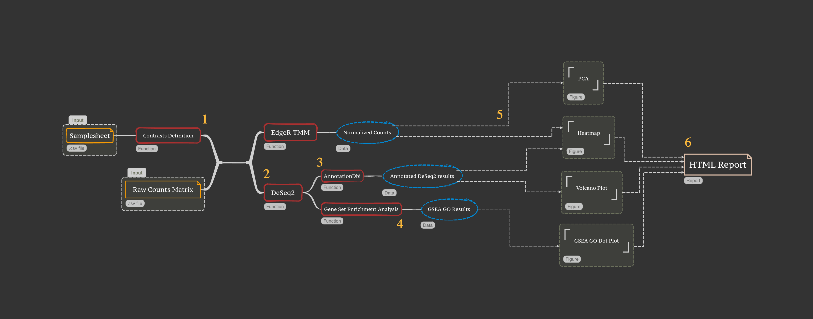
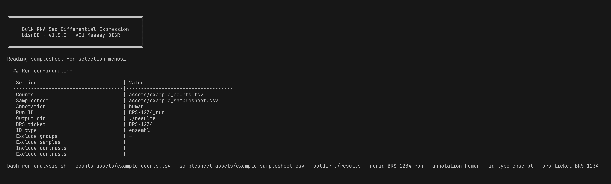

# Differential Expression Analysis Pipeline

**v1.11.0** — VCU Massey Comprehensive Cancer Center Bioinformatics Shared Resource (BISR)

## Introduction

This is a reproducible bioinformatics pipeline that performs differential gene expression analysis on bulk RNA-seq count data. It consumes a merged-counts TSV (typically from [`nf-core/rnaseq`](https://nf-co.re/rnaseq)) and a samplesheet describing contrasts, and produces a self-contained HTML report that includes:

- **Per-comparison DE**: DESeq2 with annotation (Ensembl ID, Entrez ID, gene Symbol, gene name) and four enrichment analyses (GO, KEGG, Reactome, MSigDB Hallmark).
- **Sample exploration**: 2D + 3D PCA (interactive plotly + static), Spearman correlation heatmap, vst-transformed Euclidean distance heatmap, library-size + detected-gene barplots, hierarchical clustering dendrogram + log-CPM density.
- **Manuscript-ready Methods text**, dynamically populated with tool versions and species-correct genome assembly.

Three entry points exist:

1. **Interactive launcher** (recommended) — `bash run_interactive.sh`, a guided, styled launcher that lets you pick a **bash session or a Go TUI**, walks you through every option (including sample / group / contrast selection), then hands off to `run_analysis.sh`.
2. **Standalone** — `bash run_analysis.sh ...` for scripts / CI (this README).
3. **Nextflow DSL2** — `nextflow run nf-module/main.nf ...` (see [`nf-module/README.md`](nf-module/README.md)) for **downstream chaining after `nf-core/rnaseq`**.

## Table of Contents

- [Repo layout](#repo-layout)
- [Pipeline](#pipeline)
- [Environment setup](#environment-setup)
- [Usage](#usage)
  - [Preparing your data](#preparing-your-data)
  - [Running the pipeline](#running-the-pipeline)
  - [CLI arguments](#cli-arguments)
- [Pipeline output](#pipeline-output)
- [Nextflow integration](#nextflow-integration)
- [Limitations](#limitations)
- [Utilizing IPA](#utilizing-ipa)
- [Contact](#contact)
- [License](#license)

## Repo layout

```
differential_expression/
├── README.md                 # this file
├── CHANGELOG.md              # at repo root: differential_expression/../CHANGELOG.md
├── de.R                      # thin optparse wrapper -> bisrDE::run_pipeline + generate_report
├── bin/
│   └── bisrde                # team command: bisrde run | submit | interactive | pull | version
├── modulefiles/
│   └── bisrde                # Tcl modulefile: puts bin/ on PATH and sets BISR_SIF_DIR
├── run_interactive.sh        # guided launcher (recommended): bash session OR Go TUI chooser
├── run_analysis.sh           # non-interactive executor (auto-detects mac/linux + container)
├── run_in_container.sh       # runs de.R inside the prebuilt image (called by run_analysis.sh)
├── pull_container.sh         # pulls ghcr.io/vcu-bioinformatics-core/bisrde into BISR_SIF_DIR
├── submit_slurm.sh           # sbatch template (RUNTIME=auto|container|conda)
├── Dockerfile                # code image recipe (bisrDE + de.R on the base); built by GitHub Actions
├── Dockerfile.base           # base image recipe (conda env + MSigDB cache); rebuilt only when its inputs change
├── container_base_tag.sh     # prints the base image tag (content hash of its inputs)
├── environment.yml           # conda environment (Bioconductor 3.18); the image is built from it
├── setup_renv.R              # one-time renv bootstrap helper
├── renv.lock                 # pinned R deps
├── assets/
│   ├── example_counts.tsv    # 10-gene mouse fixture (smoke test)
│   └── example_samplesheet.csv
├── bisrDE/                   # bisrDE R package (DESeq2 DE, QC, 4-backend GSEA, Quarto report)
│   ├── DESCRIPTION
│   ├── R/                    # io, normalize, de, annotate, enrich, plots_*, pipeline, cli, utils, report
│   ├── inst/qmd/             # Quarto report template + per-comparison child
│   └── tests/testthat/       # unit + behavior tests
├── tui/                      # Go TUI launcher (bubbletea/huh/lipgloss) -> bisrde-tui
│   └── README.md             # build + usage; binary is git-ignored
└── nf-module/                # Nextflow DSL2 wrapper (downstream of nf-core/rnaseq)
    ├── main.nf
    ├── modules/local/bisr_de.nf
    ├── nextflow.config
    └── tests/main.nf.test    # nf-test fixture
```

## Pipeline



1. **Parse contrasts** from the samplesheet (one column per `experiment_vs_control`; `1` = exp, `0` = ctrl, blank = exclude).
2. **Align + filter** the counts matrix to the samplesheet's `SampleID` order; round Salmon/RSEM estimates to integers; pre-filter genes with fewer than *k* samples having ≥10 reads, where *k* is the smallest group size (floor 2).
3. **Normalize** via edgeR TMM (heatmap substrate + CSV export) and DESeq2 (DE testing substrate); sample exploration (PCA, Spearman correlation) uses the blind VST of the filtered counts on all genes.
4. **DESeq2** per contrast — Wald test + Benjamini-Hochberg FDR correction.
5. **Annotate** results with Ensembl ID, Entrez ID, gene Symbol, gene name (from `org.Hs.eg.db` / `org.Mm.eg.db`).
6. **Enrichment** (independent of significance threshold; ranked-list GSEA on the DESeq2 Wald statistic by default, `--gsea-rank log2fc` restores fold-change ranking; exact p-values with `eps = 0`):
   - GO Biological Process / Molecular Function / Cellular Component (`clusterProfiler::gseGO`).
   - KEGG pathways (`clusterProfiler::gseKEGG`).
   - Reactome pathways (`ReactomePA::gsePathway`).
   - MSigDB Hallmark gene sets (`clusterProfiler::GSEA` + `msigdbr` H collection).
7. **Plots** per comparison: volcano, all-significant heatmap, top-100-by-padj heatmap (with gene Symbol labels), GSEA dotplots (split by Activated / Suppressed for each backend).
8. **Sample exploration** (across all samples): 2D + 3D PCA (interactive plotly), Spearman correlation heatmap, vst Euclidean distance heatmap, library-size + detected-gene barplots, hierarchical clustering (Ward.D2) + per-sample log-CPM density.
9. **Quarto report** — single self-contained HTML with all of the above, plus interpretation callouts, a comparisons summary table, manuscript-ready Methods + References, and an IPA upload guide.

**Significance thresholds** (`--padj`, `--fold-change`; reported in the manuscript text): `padj < 0.05` AND `|log2FC| ≥ 0.58` (≈1.5× fold change). The same strict `<` on `padj` is used everywhere (volcano, heatmaps, counts, `filter_significant()`).

## Environment setup

The launcher (`run_analysis.sh`) picks the runtime for the machine it is on: the prebuilt container on Linux servers, otherwise a conda environment or a local R with [`renv`](https://rstudio.github.io/renv/). Every runtime includes [Quarto](https://quarto.org) for report rendering. `BISR_RUNTIME` overrides the choice (see the table in the container section).

### Required tooling

| Tool      | Min version | Notes                                                                   |
|-----------|-------------|-------------------------------------------------------------------------|
| R         | 4.2         | `renv::restore()` will pull pinned package versions on first run.       |
| Quarto    | 1.5+        | Required for report rendering. Install via `brew install --cask quarto` (macOS) or [download](https://quarto.org/docs/get-started/). |
| Apptainer | 1.0+        | _Linux servers._ Runs the prebuilt image; R and Quarto then come from the image. Singularity works too. Not available on macOS. |
| Nextflow  | 22.10+      | _Optional._ Only for the Nextflow DSL2 wrapper (see [`nf-module/`](nf-module/README.md)). |

### Local macOS

First-run `renv::restore()` takes ~30-60 minutes. Afterwards, the launcher is fast:

```bash
bash run_analysis.sh \
    --counts <counts.tsv> --samplesheet <samplesheet.csv> \
    --outdir results --runid my_run --annotation mouse
```

### Linux / HPC (container, recommended)

The image `ghcr.io/vcu-bioinformatics-core/bisrde` holds the conda environment from `environment.yml` (R 4.3, Bioconductor 3.18, the Quarto CLI), the `bisrDE` package at the tagged version and the MSigDB gene sets, already downloaded. GitHub Actions builds it for x86_64 Linux on every release tag and publishes it under the version (`:<version>`, the Version field of `bisrDE/DESCRIPTION`) and `:latest`. Nothing is compiled on the server, no account needs its own R library, and the R code that runs is the copy baked into the image, so it always matches the image version.

The image is built in two layers. `bisrde-base` (`Dockerfile.base`) holds the conda environment and the MSigDB gene sets; `bisrde` (`Dockerfile`) adds the `bisrDE` package and `de.R` on top of it. The base carries a content-hash tag (`env-<hash>`, printed by `container_base_tag.sh`) and is rebuilt only when `environment.yml`, `warm_msigdb_cache.R` or `Dockerfile.base` changes, so a release build takes a few minutes and does not depend on Zenodo being reachable. The gene sets an image ships are fixed by the `r-msigdbr` pin in `environment.yml` (25.1.1, MSigDB 2025.1). The `bisrde-base` package must be made public once, like `bisrde`, so the workflow can find an existing base without a token. `just container` builds both layers locally.

Team setup, three steps. The first is done once by one person, the second by every member, the third once per version.

**1. Shared image directory and shared clone (one person, once).** Pick a directory every lab member can read, and let members add new versions to it. The setgid bit (`2775`) makes new files inherit the lab group.

```bash
mkdir -p /lustre/home/mccbnfolab/containers
chgrp <lab-group> /lustre/home/mccbnfolab/containers
chmod 2775 /lustre/home/mccbnfolab/containers

mkdir -p /lustre/home/mccbnfolab/src
git clone https://github.com/VCU-Bioinformatics-Core/bulk_rnaseq_analyses.git \
    /lustre/home/mccbnfolab/src/bulk_rnaseq_analyses
```

**2. Module and command (every member, once).** Add these lines to `~/.bashrc` or `~/.bash_profile`. If the site provides Apptainer as a module, load it first; its name differs by site (`module avail apptainer`).

```bash
module load apptainer        # only if your site provides it as a module
module use /lustre/home/mccbnfolab/src/bulk_rnaseq_analyses/differential_expression/modulefiles
module load bisrde
```

`module load bisrde` puts the `bisrde` command on PATH and sets `BISR_SIF_DIR` to `/lustre/home/mccbnfolab/containers`. A `BISR_SIF_DIR` you have already exported wins. Other sites edit the path in `modulefiles/bisrde`.

**3. Pull the image (once per version, on a login node).** The download is 3 to 4 GB and takes a few minutes.

```bash
bisrde pull
```

Then run from any directory:

```bash
# Run directly on the machine you are logged in to
bisrde run --counts counts.tsv --samplesheet samplesheet.csv \
    --outdir results --runid my_run --annotation human

# Slurm job; sbatch options such as --time=08:00:00 go first
bisrde submit COUNTS=counts.tsv SAMPLESHEET=samplesheet.csv \
    OUTDIR=results RUNID=my_run ANNOTATION=human

bisrde interactive        # guided launcher; it starts in the clone, so enter your own project and output directories
bisrde version            # pipeline version, and where its image should be
```

Relative paths in `--counts`, `--samplesheet` and `--outdir` (`COUNTS`, `SAMPLESHEET` and `OUTDIR` for `submit`) resolve against the directory you run the command from, not against the clone. Without `--outdir`, `bisrde run` writes results to `./output` in that directory; a submitted job without `OUTDIR` writes to `./results` in the submit directory. `bisrde interactive` is the exception: it runs inside the clone, so its prompts default to the clone's files and `./results` there, and you enter your own project and output directories. `bisrde submit` writes `slurm-bisrde-<jobid>.out` in the submit directory, and its values cannot contain commas. The plain forms still work from inside the clone, for example `bash run_analysis.sh --counts assets/example_counts.tsv --samplesheet assets/example_samplesheet.csv --outdir /tmp/bisrde_smoke --runid smoke --annotation mouse`.

The launcher finds `apptainer` (or `singularity`) on PATH, looks for `$BISR_SIF_DIR/bisrde_<version>.sif` and runs `de.R` inside it. On a machine with network access it pulls the image itself when the file is missing, so the pull step matters where the compute nodes are offline, which is the usual case on a cluster. A `dge_analysis.sif` next to `run_analysis.sh` from an earlier install is still used when present.

**Version pairing.** The launcher reads the version from `bisrDE/DESCRIPTION` and uses the image with the same tag; the file is named `bisrde_<version>.sif`, so several versions can sit side by side in `BISR_SIF_DIR` and an older clone keeps working. To move the team to a new release, `git pull` the shared clone and run `bisrde pull` once more; everyone who uses that clone moves together.

**Bind mounts.** The directories holding `--counts` and `--samplesheet`, the `--outdir` (created first) and the current directory are bound into the container automatically, resolved through symlinks. Anything else the run has to read goes in `BISR_BIND` as a comma-separated list of host paths. The host environment passes through, so `BISR_PLATFORM_NAME` and friends reach the run.

**Environment variables.**

| Variable        | Default                                                   | Effect |
|-----------------|-----------------------------------------------------------|--------|
| `BISR_RUNTIME`  | `auto`                                                    | `container`, `conda` or `renv` forces one runtime. `auto` picks, in order: `BISR_SIF` if set; a legacy `dge_analysis.sif` next to the launcher; conda when a conda environment is active and provides `Rscript`; the container when `apptainer` or `singularity` is on PATH; renv otherwise. On macOS: conda if active, else renv. |
| `BISR_SIF`      | unset                                                     | Path to a `.sif` to use as is. Wins over everything else. |
| `BISR_SIF_DIR`  | `${XDG_CACHE_HOME:-$HOME/.cache}/bisrde`                  | Directory holding `bisrde_<version>.sif`. Set it to a shared, group-readable directory. |
| `BISR_IMAGE`    | `docker://ghcr.io/vcu-bioinformatics-core/bisrde:<version>` | Image reference pulled when the SIF is missing. |
| `BISR_NO_PULL`  | unset                                                     | `1` disables pulling: a missing SIF is an error that says to run `pull_container.sh` on a login node. `submit_slurm.sh` sets it. |
| `BISR_BIND`     | unset                                                     | Extra host paths to bind, comma separated. |
| `BISR_DRY_RUN`  | unset                                                     | `1` prints the resolved runtime and the exact command, then exits without running anything. |

Note the order in `auto`: a shell with a conda environment activated runs in that environment, not in the container. Deactivate it, or set `BISR_RUNTIME=container`, to use the image.

**macOS.** Apptainer does not run on macOS, so the launcher never picks the container there. Mac users use the conda or renv path below.

**Validation.** The image is built from the same `environment.yml` as the conda path, so a container run and a conda run of the bundled example are expected to agree:

```bash
Rscript compare_runs.R --a <conda_run> --b <container_run> --out validation.md
```

Exit status is 0 PASS / 1 WARN / 2 FAIL, so it can gate a deployment.

#### Batch submission

`submit_slurm.sh` is a ready sbatch template (4 cpus / 32 G / 4 h by default). The `RUNTIME` knob in its CONFIG block picks the runtime: `auto` (the default) uses the container when `apptainer` or `singularity` is on PATH and the SIF already exists: `$BISR_SIF_DIR/bisrde_<version>.sif`, or the file named by `BISR_SIF` when that is set; conda otherwise. `container` and `conda` force one.

`bisrde submit` is the shortest route. It collects the `KEY=VALUE` words into one `--export` list, adds `PIPELINE_DIR` so the job finds the shared clone, turns relative `COUNTS`, `SAMPLESHEET` and `OUTDIR` into absolute paths, and calls `sbatch` on `submit_slurm.sh`. Words that start with a dash go to `sbatch` unchanged and must come first, written as `--option=value`.

```bash
# bisrde submit. Run `bisrde pull` on a login node first: compute nodes have no network.
bisrde submit --time=08:00:00 COUNTS=counts.tsv SAMPLESHEET=samplesheet.csv \
    OUTDIR=results RUNID=my_run ANNOTATION=human

# container, with sbatch directly
export BISR_SIF_DIR=/lustre/home/<lab>/containers
sbatch --export=ALL,RUNTIME=container,COUNTS=/path/counts.tsv,SAMPLESHEET=/path/ss.csv,\
OUTDIR=$PWD/results,RUNID=my_run,ANNOTATION=human submit_slurm.sh

# conda: submit from the activated environment
micromamba activate bisrde
sbatch --export=ALL,RUNTIME=conda,COUNTS=/path/counts.tsv,SAMPLESHEET=/path/ss.csv,\
OUTDIR=$PWD/results,RUNID=my_run,ANNOTATION=human submit_slurm.sh

# method knobs (defaults: GSEA_RANK=stat LFC_SHRINK=apeglm INDEPENDENT_FILTERING=yes)
sbatch --export=ALL,GSEA_RANK=log2fc,LFC_SHRINK=none,INDEPENDENT_FILTERING=no,COUNTS=...,SAMPLESHEET=... submit_slurm.sh

squeue -u "$USER"
tail -f slurm-bisrde-<jobid>.out
```

`--export=ALL` carries `BISR_SIF_DIR` into the job, so export it before `sbatch` or load the module in the shell profile. Without `bisrde submit`, pass `PIPELINE_DIR=<clone>/differential_expression` in `--export` to submit from another directory. In container mode the job skips the conda activation and the MSigDB preflight, because the gene sets are baked into the image; a missing SIF fails at job start with the `pull_container.sh` instruction instead of attempting a pull from a compute node.

The template exports `BISR_PLATFORM_NAME` (default "VCU's High Performance Research Computing (HPRC) cluster", override with `PLATFORM_NAME=...`), which the report's Methods text names as where the analysis ran.

In conda mode, before the analysis starts, the job resolves the MSigDB cache directory the way R will (`R_USER_CACHE_DIR` included), prints it in the job header as `msigdb:`, and warns in the `.err` log with the exact warm-up command if the directory is missing or empty. The run continues, since Hallmark is the only step that needs the cache; warm it and resubmit if you want Hallmark results.

KEGG is the one backend that needs outbound network at run time, because `clusterProfiler::gseKEGG` fetches the pathway data live and there is no offline cache. On a node without it the report marks KEGG as `unreachable` in the summary table and names the reason, while the other backends and the rest of the report are unaffected. Run on a node with network access if you want KEGG results.

Raise `--mem` before `--cpus-per-task` if a job is killed; DESeq2 and the four
GSEA backends are memory-bound rather than CPU-bound.

### Linux / HPC (conda, alternative)

Use this where Apptainer is not installed, or when you want to run R code that differs from the released image. Start to finish:

```bash
# 1. Code
git clone https://github.com/VCU-Bioinformatics-Core/bulk_rnaseq_analyses.git
cd bulk_rnaseq_analyses/differential_expression

# 2. Environment. If your site has no conda, bootstrap micromamba into $HOME
#    (single static binary, no admin rights, ~10 MB):
#      curl -Ls https://micro.mamba.pm/api/micromamba/linux-64/latest | tar -xvj bin/micromamba
#      export PATH="$PWD/bin:$PATH"
micromamba create -n bisrde -f environment.yml \
    --override-channels -c conda-forge -c bioconda -y
micromamba activate bisrde          # or: conda activate bisrde

# 3. ONE-TIME: stop renv from hijacking this environment.
#    The repo ships a .Rprofile that auto-activates renv, which points R at an
#    empty project library and hides everything conda installed (the symptom is
#    "there is no package called 'remotes'"). Baking the setting into the env
#    means every future activation is safe — including plain `Rscript` calls.
mkdir -p "$CONDA_PREFIX/etc/conda/activate.d"
echo 'export RENV_CONFIG_AUTOLOADER_ENABLED=FALSE' \
    > "$CONDA_PREFIX/etc/conda/activate.d/renv_off.sh"
micromamba deactivate && micromamba activate bisrde

Rscript -e '.libPaths()'   # sanity: must be inside $CONDA_PREFIX, not renv/library

# 4. The pipeline package itself
Rscript -e 'remotes::install_local("bisrDE", upgrade = "never")'

# 5. Smoke-test on the bundled 10-gene fixture (~2 min)
bash run_analysis.sh --counts assets/example_counts.tsv \
    --samplesheet assets/example_samplesheet.csv \
    --outdir /tmp/bisrde_smoke --runid smoke --annotation mouse
```

```bash
# 6. ONE-TIME: pre-download the MSigDB gene sets, ON A LOGIN NODE.
#    msigdbr fetches its archive from Zenodo on first use. Compute nodes
#    usually have no outbound internet, so without this every run fails with
#    "MSigDB Hallmark error: Timeout was reached [zenodo.org]" and silently
#    produces no Hallmark enrichment. (The container ships this cache; only
#    the conda and renv paths need the warm-up.)
Rscript warm_msigdb_cache.R
```

> **If the cluster has no outbound internet at all** (login nodes included —
> check with `curl -sI https://zenodo.org`), warm the cache on your laptop and
> copy it across. It is ~85 MB:
>
> ```bash
> # on the machine WITH internet
> Rscript warm_msigdb_cache.R
> Rscript -e 'cat(tools::R_user_dir("msigdbr","cache"))'   # prints the source dir
>
> # then, from that machine (Linux target path is ~/.cache/R/msigdbr)
> ssh <cluster> 'mkdir -p ~/.cache/R/msigdbr'
> rsync -avP "<source dir>/" <cluster>:~/.cache/R/msigdbr/
> ```

If step 5 produces `rnaseq_analysis_*.html`, the install is good.

> **If `$HOME` is not shared with the compute nodes**, point the cache at a
> shared filesystem instead — set `R_USER_CACHE_DIR` to the same path when
> warming the cache *and* in your job script:
>
> ```bash
> export R_USER_CACHE_DIR=/lustre/home/<lab>/rcache
> Rscript warm_msigdb_cache.R
> ```
>
> Verified: with the cache warm, Hallmark enrichment returns all 50 gene sets
> with outbound network fully blocked.
>
> Everything in this section needs only `R` — `just` is a developer convenience
> and is not required on the cluster.

> **If you skipped step 3**, any direct `Rscript` call fails with
> `there is no package called 'remotes'` (or any other conda-installed
> package). That is renv's autoloader pointing R at an empty project library.
> One-off escape hatch:
>
> ```bash
> RENV_CONFIG_AUTOLOADER_ENABLED=FALSE Rscript -e '...'
> ```
>
> `run_analysis.sh` sets this itself when it sees an activated conda env, so
> pipeline *runs* are safe either way — it is direct `Rscript` invocations
> (installing the package, `de.R`, `compare_runs.R`) that need step 3.

**Note:** `environment.yml` pins **Bioconductor 3.18 / R 4.3**, not the
`renv.lock` 3.16 — Bioc 3.16 is not installable from bioconda (see the header
of `environment.yml` for the two blocking dependency conflicts). Results are
therefore *near*-equivalent to a renv run, not identical. The container is
built from this same file, so it carries the same versions.

### Linux / HPC (renv)

Identical command; the launcher falls back to local R + renv when neither Apptainer nor an active conda environment is found (or when `BISR_RUNTIME=renv`). The MSigDB warm-up from step 6 above applies here too.

```bash
module load R/4.2.1   # or your HPC's R module
bash run_analysis.sh ...
```

## Usage

### Preparing your data

Two input files are required: the **merged counts matrix** and the **samplesheet**.

#### 1. Merged counts (TSV)

The **first column is the gene identifier** (`gene_id`, `Geneid`, …); the remaining columns are **per-sample counts** whose headers must match the samplesheet's `SampleID` values. Known metadata columns are recognised **by name and dropped automatically**, so the common `nf-core/rnaseq` count-file organizations work as-is (no reformatting needed):

| Quantifier | File | Layout |
|------------|------|--------|
| salmon | `salmon.merged.gene_counts.tsv` | `gene_id, gene_name, <samples…>` |
| RSEM | `rsem.merged.gene_counts.tsv` | `gene_id, transcript_id(s), <samples…>` |
| featureCounts-style | — | `Geneid, Chr, Start, End, Strand, Length, <samples…>` |

The dropped names include `gene_name`, `transcript_id(s)`, `Chr`, `Start`, `End`, `Strand`, `Length`, `biotype`, and `description` — so the numeric `Start`/`End`/`Length` annotation columns are **not** mistaken for samples. Ensembl gene-ID version suffixes (`ENSG…​.4`) are stripped and `_PAR_Y` pseudo-autosomal duplicates dropped, while gene **symbols** that contain dots (e.g. `H2-M10.1`) are left intact.

| gene_id            | sample1_r1 | sample1_r2 | sample1_r3 | sample2_r1 | sample2_r2 | sample2_r3 |
|--------------------|------------|------------|------------|------------|------------|------------|
| ENSMUSG00000000001 | 1234       | 2345       | 3456       | 4567       | 5678       | 6789       |
| ENSMUSG00000000002 | 1234       | 2345       | 3456       | 4567       | 5678       | 6789       |

Ensembl version suffixes (e.g. `ENSG00000123.4`) are stripped automatically.

#### 2. Samplesheet (CSV)

Must contain at least these columns: `SampleID`, `GroupID`, then one column per contrast. Each contrast column encodes `1` = experimental, `0` = control, blank = excluded.

| SampleID   | GroupID     | exp1_vs_ctrl1 | exp2_vs_ctrl2 |
|------------|-------------|---------------|---------------|
| sample1_r1 | experiment1 | 1             |               |
| sample1_r2 | experiment1 | 1             |               |
| sample2_r1 | control1    | 0             |               |
| sample3_r1 | experiment2 |               | 1             |
| sample4_r1 | control2    |               | 0             |

**Optional columns** (v1.5.0+) — placed anywhere between `GroupID` and the contrast columns; they are recognised by name and never treated as contrasts:

- `DisplayName` — a human-readable label shown on every sample-labelled figure (heatmaps, barplots, dendrogram, PCA) instead of the `SampleID`. The `SampleID` stays the count-matrix join key; only the labels change. Blank cells fall back to the `SampleID`.
- `Exclude` — set to `1` / `TRUE` / `yes` to drop that sample from the entire analysis. Use this for a permanent "this sample was contaminated" record.

| SampleID   | GroupID  | DisplayName | Exclude | hpvPos_vs_hpvNeg |
|------------|----------|-------------|---------|------------------|
| SRR2219887 | hpvPos   | HPV+ #1     |         | 1                |
| SRR2219889 | hpvPos   | HPV+ #2     |         | 1                |
| SRR2219873 | hpvNeg   | HPV− #1     |         | 0                |
| SRR2219895 | hpvNeg   | HPV− #2     | 1       | 0                |   ← dropped |

### Running the pipeline

Two entry points:

- **`run_interactive.sh`** (v1.5.0+, recommended) — a guided, styled launcher that walks you through every option, including interactive sample / group / contrast selection, then hands off to `run_analysis.sh`.
- **`run_analysis.sh`** — the non-interactive executor (use this in scripts / CI / Nextflow). Never call `Rscript de.R` directly; the launcher handles environment detection.

#### Interactive launcher (recommended)

```bash
bash run_interactive.sh
```



The launcher first asks you to **choose a front-end**:

- **Bash interactive session** — styled shell prompts (uses [charmbracelet `gum`](https://github.com/charmbracelet/gum) / `glow` when installed, plain `read` prompts otherwise).
- **Go TUI** (`tui/bisrde-tui`, v1.11.0) — a [bubbletea](https://github.com/charmbracelet/bubbletea) / [huh](https://github.com/charmbracelet/huh) / [lipgloss](https://github.com/charmbracelet/lipgloss) form. If the binary isn't built yet it offers to build it for you (needs Go 1.23+); see [`tui/README.md`](tui/README.md) for build / cross-compile details. You can also run it directly: `./tui/bisrde-tui`.

Either way you're walked through the counts file, samplesheet, annotation, run ID, output dir, and optional BRS ticket / ID type, then — by reading the samplesheet — offered **multi-select menus to exclude groups / samples and choose which contrasts to run** (wiring directly into the selection features below). A summary is shown for confirmation, and both front-ends assemble the **exact same `run_analysis.sh` command** (a maintained parity contract).

For the polished bash experience (borders, colors, fuzzy multi-select, markdown summary) install the optional [charmbracelet](https://github.com/charmbracelet) tools:

```bash
brew install gum glow freeze    # macOS; see charmbracelet repos for Linux
```

Without them the bash launcher falls back to plain prompts — it always works. The launcher is also scriptable / non-interactive: set `BISR_*` environment variables (e.g. `BISR_COUNTS`, `BISR_SAMPLESHEET`, `BISR_ANNOTATION`, `BISR_RUNID`, `BISR_ANALYST`, `BISR_EXCLUDE_GROUPS`, `BISR_FRONTEND`, …) and pass `--print-cmd` to print the assembled `run_analysis.sh` command without executing it.

#### Mouse analysis

```bash
bash run_analysis.sh \
    --counts mouse_counts.tsv \
    --samplesheet samplesheet.csv \
    --outdir mouse_results \
    --runid mouse_experiment \
    --annotation mouse
```

#### Human analysis with BRS ticket and Entrez IDs

```bash
bash run_analysis.sh \
    --counts human_counts.tsv \
    --samplesheet samplesheet.csv \
    --outdir human_results \
    --runid BRS-1234_run \
    --annotation human \
    --brs-ticket BRS-1234 \
    --id-type entrez
```

#### Smoke test against the bundled fixture

```bash
bash run_analysis.sh \
    --counts assets/example_counts.tsv \
    --samplesheet assets/example_samplesheet.csv \
    --outdir /tmp/bisrDE_smoke \
    --runid smoke_$(date +%s) \
    --annotation mouse \
    --brs-ticket BRS-TEST-0000
```

This runs in ~1-2 minutes on a modern Mac / HPC node and produces `/tmp/bisrDE_smoke/rnaseq_analysis_<timestamp>.html`. Use this to verify the install end-to-end before pointing the pipeline at real data.

### CLI arguments

| Flag                | Short | Required | Default        | Description                                                                 |
|---------------------|-------|----------|----------------|-----------------------------------------------------------------------------|
| `--counts`          | `-c`  | yes      | —              | Merged counts TSV.                                                          |
| `--samplesheet`     | `-s`  | yes      | —              | Samplesheet CSV with `SampleID`, `GroupID`, contrast columns.               |
| `--outdir`          | `-o`  | no       | `./output`     | Output directory (created if missing).                                      |
| `--runid`           | `-r`  | yes      | —              | Unique identifier for this run; appears in the report.                      |
| `--annotation`      | `-a`  | no       | `human`        | `human` or `mouse`. Selects OrgDb + KEGG / Reactome / MSigDB organism.      |
| `--brs-ticket`      | `-b`  | no       | (none)         | BRS ticket identifier (e.g. `BRS-1234`). Renders as a subtitle in the report. |
| `--analyst`         |       | no       | `Mikail Bala`  | Analyst name shown in the report header. Env: `BISR_ANALYST`. |
| `--id-type`         | `-i`  | no       | `ensembl`      | `ensembl`, `entrez`, or `symbol`. Identifier type in the count matrix rownames. Output CSVs always carry all four ID columns regardless. |
| `--exclude-samples` |       | no       | (none)         | Comma-separated `SampleID`s to drop from the whole analysis (e.g. `SRR1,SRR2`). Unions with the `Exclude` column. |
| `--exclude-groups`  |       | no       | (none)         | Comma-separated `GroupID`s to drop from the whole analysis. |
| `--include-contrasts` |     | no       | (none)         | Comma-separated contrast columns to process **exclusively** (allowlist). |
| `--exclude-contrasts` |     | no       | (none)         | Comma-separated contrast columns to **skip** (denylist). |
| `--gsea-rank`       |       | no       | `stat`         | Ranking metric for pre-ranked GSEA: `stat` (DESeq2 Wald statistic) or `log2fc` (pre-v1.7 behaviour). Env: `BISR_GSEA_RANK`. |
| `--lfc-shrink`      |       | no       | `apeglm`       | Log2 fold-change shrinkage (`apeglm`, `normal`, `none`). Adds `log2FC_shrunken` / `lfcSE_shrunken` to the DE CSV and places volcano points at the shrunken value; DEG calls always use the unshrunken estimate. Falls back to `normal` when apeglm is not installed. Env: `BISR_LFC_SHRINK`. |
| `--independent-filtering` |  | no      | `yes`          | DESeq2 independent filtering, `yes` or `no`. `yes` is DESeq2's own default and the recommended setting; it gains power on low-count genes and leaves `padj` empty for the genes it filters. `no` keeps an adjusted p-value for every tested gene (the behaviour up to v1.8.0). Env: `BISR_INDEPENDENT_FILTERING`. |

**Examples.** Re-run dropping a QC outlier without editing the samplesheet:

```bash
bash run_analysis.sh --counts c.tsv --samplesheet ss.csv --outdir out --runid rerun \
    --annotation human --exclude-samples SRR2219895
```

Run only one contrast from a 12-contrast samplesheet:

```bash
bash run_analysis.sh --counts c.tsv --samplesheet ss.csv --outdir out --runid focused \
    --annotation human --include-contrasts hpvPos_vs_hpvNeg
```

## Pipeline output

```
<outdir>/
├── rnaseq_analysis_<timestamp>.html   # main deliverable: self-contained Quarto report
├── analysis_results_<timestamp>.rds   # re-renderable analysis bundle (re-run generate_report on it)
├── data/
│   ├── de_data/
│   │   ├── DESeq2_<comparison>.csv
│   │   └── normalizedCounts_tmm<date>.csv
│   ├── gsea_data/                     # GO results
│   ├── kegg_data/                     # KEGG pathway results
│   ├── reactome_data/                 # Reactome pathway results
│   └── hallmark_data/                 # MSigDB Hallmark results
├── figures/
│   ├── volcano/<comparison>_volcano.png
│   ├── heatmap/
│   │   ├── <comparison>_heatmap_all_sig.png      # all DEGs
│   │   └── <comparison>_heatmap_top100.png       # top 100 by padj, gene-symbol labels
│   ├── gsea/<comparison>_GSEA.png                # GO dotplot
│   ├── kegg/<comparison>_KEGG.png
│   ├── reactome/<comparison>_Reactome.png
│   ├── hallmark/<comparison>_Hallmark.png
│   ├── pca/
│   │   ├── PCA_plot.png
│   │   ├── allsamples_PCA_plot.html              # interactive 2D plotly
│   │   └── allsamples_PCA_plot3D.html            # interactive 3D plotly
│   └── qc/
│       ├── qc_correlation_heatmap.png            # Spearman, all genes (blind VST)
│       ├── qc_vst_dist_heatmap.png               # vst Euclidean distance
│       ├── qc_libsize_detected.png               # library size + detected genes
│       └── qc_hclust_density.png                 # Ward dendrogram + log-CPM density
└── logs/
    └── <timestamp>_session.log                   # tee'd cli output
```

The report HTML is the primary deliverable — it embeds every plot, every results table (with sortable / searchable DT widgets), and the manuscript-ready Methods + References. The CSVs and PNGs are produced for downstream use (IPA upload, manuscript figures, archival).

### Significant DE table columns

| Column           | Meaning                                                                                  |
|------------------|------------------------------------------------------------------------------------------|
| `ENSEMBL_ID`     | Ensembl gene ID (always present, regardless of input `--id-type`).                       |
| `ENTREZID`       | NCBI Entrez gene ID.                                                                     |
| `SYMBOL`         | Gene symbol (e.g. `TP53`).                                                                |
| `GENENAME`       | Full gene name.                                                                           |
| `baseMean`       | Average normalized expression across all samples.                                         |
| `log2FoldChange` | Log2 ratio of expression (exp / ctrl). Positive = up in the experimental group.           |
| `lfcSE`          | Standard error of the log2FC estimate.                                                    |
| `stat`           | Wald test statistic.                                                                      |
| `pvalue`         | Raw Wald p-value.                                                                         |
| `padj`           | Benjamini-Hochberg adjusted p-value (FDR).                                                |
| `log2FC_shrunken` | Shrunken log2FC (`--lfc-shrink`, default apeglm). For plots and effect-size reporting only; DEG calls use `log2FoldChange`. |
| `lfcSE_shrunken` | Standard error of the shrunken estimate.                                                  |
| `SYMBOL_SOURCE`  | `orgdb` when the symbol came from org.*.eg.db, `input` when it came from the count file's `gene_name` column (OrgDb had none), `NA` when neither. |
| `ENSEMBL_ID_VERSIONED` | The original versioned accession from the count file (present when the input carried versions). |

## Nextflow integration

For pipelines that already chain `nf-core/rnaseq`, the `nf-module/` directory provides a DSL2 wrapper. See [`nf-module/README.md`](nf-module/README.md) for a full integration example and `nf-test` setup. Quickstart:

The wrapper exposes the options of v1.5.3 (`--counts`, `--samplesheet`, `--outdir`, `--runid`, `--annotation`, `--id-type`). Flags added since are not wired through (`--exclude-samples`, `--exclude-groups`, `--exclude-contrasts`, `--include-contrasts`, `--volcano-labels`, `--fold-change`, `--padj`, `--gsea-rank`, `--lfc-shrink`, `--independent-filtering`, `--analyst`), so a Nextflow run uses their defaults, and the manifest predates them. No client project runs this path; it stays for pipelines that chain `nf-core/rnaseq` and will be brought to parity when one needs it.

```bash
nextflow run nf-module/main.nf \
    --counts assets/example_counts.tsv \
    --samplesheet assets/example_samplesheet.csv \
    --runid demo \
    --annotation mouse \
    --outdir results/
```

## Limitations

- **Pairwise comparisons only**. Multi-factor designs and covariates are out of scope for now (tracked for a future release).
- **Two species supported**: human (GRCh38) and mouse (GRCm39). Other species require an OrgDb + KEGG-organism-code config that we have not generalized yet.
- **No batch correction** (sva / ComBat) — explicit out-of-scope decision.
- **Container image is x86_64 only** — Apple silicon Macs run the local-R path (which is fully supported).

## Utilizing IPA

The per-comparison `data/de_data/DESeq2_<comparison>.csv` files are pre-formatted for direct upload to **QIAGEN Ingenuity Pathway Analysis (IPA)**. Massey BISR has a VCU site license; if you don't have an account, email **morecockcm@vcu.edu** with your name and VCU email. Login: <https://analysis.ingenuity.com/pa>. Step-by-step instructions are in the [QIAGEN knowledge base](https://qiagen.my.salesforce-sites.com/KnowledgeBase/KnowledgeNavigatorPage?id=kA41i000000L6rMCAS). BISR runs an annual hands-on IPA training in early fall — email us to be added to the list.

The full **manuscript-ready Methods + References + Required Acknowledgements** appear at the bottom of every report HTML, with tool versions populated dynamically.

## Contact

For questions or issues: <mccbioinfo@vcu.edu> or open a GitHub issue at <https://github.com/VCU-Bioinformatics-Core/bulk_rnaseq_analyses>.

## License

[GPL-3.0](https://github.com/VCU-Bioinformatics-Core/bulk_rnaseq_analyses/blob/main/LICENSE).

## Key references

- Love MI, Huber W, Anders S. _Moderated estimation of fold change and dispersion for RNA-seq data with DESeq2._ Genome Biology, 15:550 (2014). doi:10.1186/s13059-014-0550-8
- Subramanian A, Tamayo P, Mootha VK, et al. _Gene set enrichment analysis: a knowledge-based approach for interpreting genome-wide expression profiles._ PNAS, 102(43):15545-15550 (2005). doi:10.1073/pnas.0506580102
- Yu G, Wang LG, Han Y, He QY. _clusterProfiler: an R package for comparing biological themes among gene clusters._ OMICS, 16(5):284-287 (2012). doi:10.1089/omi.2011.0118
- Ewels P, Peltzer A, Fillinger S, et al. _The nf-core framework for community-curated bioinformatics pipelines._ Nat Biotechnol, 38:276-278 (2020). doi:10.1038/s41587-020-0439-x
- Robinson MD, McCarthy DJ, Smyth GK. _edgeR: a Bioconductor package for differential expression analysis of digital gene expression data._ Bioinformatics, 26(1):139-140 (2010). doi:10.1093/bioinformatics/btp616

Full citation list (with versions and accessed-on dates) appears in the **References** section of every rendered report HTML.
